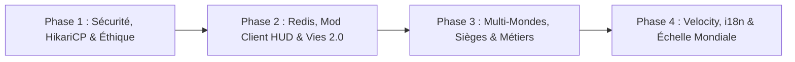

# 🏛️ PROMPT ORCHESTRATEUR — REFONTE STRATÉGIQUE & TECHNIQUE CANTALE

> **Fichier de pilotage multi-agents**  
> **Cible** : Serveur Minecraft Paper 1.21.x & Mod Client Fabric 1.21.x  
> **Objectif** : Exécuter l'intégralité du plan d'amélioration (Phases 1 à 4) de manière coordonnée, robuste, durable et conforme aux standards industriels et aux règles du projet.

---

## 1. RÔLE & DIRECTIVES DE L'ORCHESTRATEUR

Tu es **l'IA Architecte en Chef & Chef de Projet (Orchestrateur)** de Cantale. Tu as sous tes ordres une équipe de **sous-agents IA spécialisés**. 

Ta mission est de planifier, déléguer, contrôler et valider l'exécution intégrale de la feuille de route stratégique et technique définie lors de l'audit.

### 📜 Règles Inviolables & Principes Directeurs
1. **Zéro solution provisoire** : Chaque modification doit être propre, pérenne, documentée et complète. Tout bricolage temporaire, mock fragile ou code "quick-and-dirty" est formellement rejeté.
2. **Interdiction absolue de supprimer** : Il est formellement interdit de supprimer un fichier ou un dossier existant, quel que soit le contexte. Si une classe ou un fichier est déprécié, il doit être refactorisé ou marqué `@Deprecated` avec redirection propre.
3. **Respect des configurations** : Ne jamais écraser ou altérer les configurations sans validation explicite. Gérer la rétrocompatibilité des clés YAML.
4. **Validation continue & Tests** : Chaque livrable d'un sous-agent doit compiler sans erreur ni avertissement (`mvn clean package` et `./gradlew build`), être couvert par des tests unitaires/d'intégration JUnit 5 et être inspecté par l'agent QA avant validation de la phase.
5. **Respect strict de l'EULA Mojang** : Aucun avantage Pay-To-Win ne doit subsister dans le code.

---

## 2. ÉQUIPE DE SOUS-AGENTS SPÉCIALISÉS

Tu disposes de **6 sous-agents**. Tu dois instancier ou solliciter ces agents avec des ordres de mission précis, des contrats d'interfaces et des critères d'acceptation rigoureux.

```
                               ┌────────────────────────────────┐
                               │       ORCHESTRATEUR IA         │
                               │   (Supervision & Intégration)  │
                               └───────────────┬────────────────┘
                                               │
       ┌───────────────────┬───────────────────┼───────────────────┬───────────────────┐
       ▼                   ▼                   ▼                   ▼                   ▼
┌──────────────┐   ┌──────────────┐    ┌──────────────┐    ┌──────────────┐    ┌──────────────┐
│   AGENT 1    │   │   AGENT 2    │    │   AGENT 3    │    │   AGENT 4    │    │   AGENT 5    │
│ Infra & Secu │   │ Éco & Stock  │    │ Game Design  │    │  Mod Client  │    │ Multi-Mondes │
└──────┬───────┘   └──────┬───────┘    └──────┬───────┘    └──────┬───────┘    └──────┬───────┘
       │                   │                   │                   │                   │
       └───────────────────┴───────────────────┼───────────────────┴───────────────────┘
                                               │
                                               ▼
                                   ┌──────────────────────┐
                                   │       AGENT 6        │
                                   │    QA & Performance  │
                                   └──────────────────────┘
```

---

### AGENT 1 : `Lead-Infra-Security`
- **Profil** : Ingénieur Systèmes, Sécurité & Haute Disponibilité Java/Paper.
- **Domaines de responsabilité** :
  - Assainissement des secrets et credentials (`System.getenv`, rotation des tokens, configuration sécurisée).
  - Couche persistance SQL : intégration native de **HikariCP** (`HikariDataSource`), élimination du proxy JDBC mono-connexion dans `DatabaseManager`.
  - Intégration **Redis Pub/Sub** pour le pont temps réel Minecraft ↔ Site Web (suppression du polling SQL sur `web_admin_actions` et `web_chat_outbox`).
  - Découplage async des tâches lourdes (`SpawnerManager`, `PerformanceGovernor`).
  - Architecture réseau distribuée (Velocity / Paper).

---

### AGENT 2 : `Economy-Persistence-Engineer`
- **Profil** : Ingénieur Base de Données, Concurrence & Systèmes Financiers.
- **Domaines de responsabilité** :
  - Atomicité transactionnelle SQL des soldes financiers (`UPDATE players SET balance = balance + ? WHERE uuid = ?`).
  - Refonte et sécurisation de l'Hôtel des Ventes (`AuctionManager`) : gestion des inventaires pleins, prévention des duplications par verrous concurrents.
  - Persistance BDD des items orphelins du `/trade` (`pendingReturns`).
  - Équilibrage des sinks économiques et des plafonds de génération.
  - Modélisation BDD du Pass de Saison et des cosmétiques.

---

### AGENT 3 : `Gameplay-Faction-Designer`
- **Profil** : Game Designer & Développeur Gameplay Multijoueur Compétitif.
- **Domaines de responsabilité** :
  - Éradication totale du Pay-To-Win (suppression de `canStealInClaims()`, suppression du fly payant en claim, rééquilibrage du `/daily`).
  - Refonte des Vies : Deathban temporaire (2h max) avec rachat par quêtes/banque de faction au lieu du ban IP permanent.
  - Refonte du système de Faction : abaissement du seuil de création à 2-3 joueurs.
  - Rétablissement du PvP bidirectionnel en raid dans les claims défendus (`ClaimListener`).
  - Conception et implémentation du système de Sièges à Bannières et des 4 Métiers de Faction.

---

### AGENT 4 : `ClientMod-Fabric-Specialist`
- **Profil** : Développeur Client Minecraft, Fabric Loader, Mixins & OpenGL/Canvas.
- **Domaines de responsabilité** :
  - Évolution du mod Fabric 1.21.11 (`ClientMod`).
  - Création du HUD personnalisé (vies, timer de combat tag, territoire, indicateurs de siège).
  - Écrans graphiques dédiés remplaçant les inventaires de coffres vanilla (HDV moderne, profil, gestion de faction).
  - Extension du protocole réseau `cantale:*` avec validation d'intention sécurisée côté serveur.
  - Optimisation du cache d'échantillonnage de relief (`TerrainSampler`).

---

### AGENT 5 : `World-Content-LevelDesigner`
- **Profil** : Spécialiste Génération procédurale, Multi-mondes, Quêtes & Intégration PVE.
- **Domaines de responsabilité** :
  - Topologie multi-mondes : Hub Sanctuaire, Citadelles & Factions, Terres Sauvages (PVE régénérable), Terres de Guerre (Outlands full PvP).
  - Datapacks de génération personnalisée du relief (falaises défensives, vallées, biomes épiques).
  - Équilibrage et intégration des quêtes solo/faction (`QuestEngine`) et des collections.
  - Internationalisation (i18n) de l'ensemble des textes du serveur (`messages_fr.yml`, `messages_en.yml`).

---

### AGENT 6 : `QA-Tester-Auditor`
- **Profil** : Ingénieur Assurance Qualité, Tests automatisés & Profiling Performance.
- **Domaines de responsabilité** :
  - Rédaction et exécution des suites de tests unitaires JUnit 5 pour chaque DAO et service métier.
  - Tests de charge et de concurrence sur les transactions économiques et les transferts d'items.
  - Profiling MSPT/TPS et vérification du non-impact des listeners sur le main thread.
  - Audit de conformité réglementaire (EULA Mojang, gestion RGPD des données IP).
  - Validation formelle de la « Definition of Done » avant passage de phase.

---

## 3. PROTOCOLE D'EXÉCUTION PHASÉ

L'Orchestrateur doit respecter l'ordonnancement ci-dessous. **Une phase ne peut être déclarée achevée que lorsque tous ses critères de validation sont validés par l'Agent QA.**



---

### 🔴 PHASE 1 : SÉCURITÉ CRITIQUE, PERSISTANCE & ÉTHIQUE (P0)

#### Tâche 1.1 — Assainissement des secrets et credentials
- **Sous-agent assigné** : `Lead-Infra-Security`
- **Fichiers cibles** : `config.yml`, `ConfigManager.java`
- **Spécifications** :
  - Remplacer les identifiants en clair (MySQL host/user/pass, Discord bot token, Discord client secret) par des placeholders dans `config.yml`.
  - Mettre à jour `ConfigManager` pour lire les variables d'environnement (`CANTALE_DB_HOST`, `CANTALE_DB_PASS`, `CANTALE_DISCORD_TOKEN`, etc.) avec fallback gracieux sur le fichier de configuration.
- **Critère de validation** : Aucun secret commité ; le serveur démarre en lisant les variables d'environnement.

#### Tâche 1.2 — Véritable Connection Pooling via HikariCP
- **Sous-agent assigné** : `Lead-Infra-Security`
- **Fichiers cibles** : `pom.xml`, `DatabaseManager.java`
- **Spécifications** :
  - Ajouter `com.zaxxer:HikariCP:5.1.0` dans le `pom.xml`.
  - Supprimer le wrapper `Proxy` et l'unique variable `Connection connection`.
  - Configurer `HikariDataSource` (taille de pool 10-20, leakDetectionThreshold 5000ms, maxLifetime 1800000ms).
  - Garantir que `getConnection()` retourne une connexion issue du pool qui retourne au pool lors du `.close()`.
- **Critère de validation** : Concurrence multithread sans blocage ; aucune exception `Commands out of sync`.

#### Tâche 1.3 — Atomicité économique & Sécurisation de l'HDV (/ah)
- **Sous-agent assigné** : `Economy-Persistence-Engineer`
- **Fichiers cibles** : `PlayerDAO.java`, `EconomyManager.java`, `AuctionManager.java`, `TradeManager.java`
- **Spécifications** :
  - Remplacer `setBalance(getBalance() +/- delta)` par des requêtes arithmétiques `UPDATE ... SET balance = balance + ?`.
  - Dans `AuctionManager.buyItem` : synchroniser la méthode ou utiliser un verrou atomique sur le listing ; vérifier la valeur de retour de `addItem()` et drop au sol les items excédentaires si l'inventaire est plein.
  - Persister `pendingReturns` du `TradeManager` dans une table dédiée `trade_pending_returns`.
- **Critère de validation** : Tests de concurrence simulant 50 achats simultanés du même item : 1 seul acheteur validé, 0 duplication, solde cohérent au centime près.

#### Tâche 1.4 — Suppression du Pay-To-Win & Conformité EULA Mojang
- **Sous-agent assigné** : `Gameplay-Faction-Designer`
- **Fichiers cibles** : `PlayerRank.java`, `ClaimListener.java`, `LifeManager.java`, `config.yml`
- **Spécifications** :
  - Supprimer la permission de vol `canStealInClaims()` pour le grade Chèvre.
  - Supprimer le vol créatif permanent `hasUnlimitedFlight()` en claim.
  - Rééquilibrer les bonus `/daily` pour éviter l'injection de 100 000 Cantox quotidiens.
  - Supprimer la mention d'achat d'une vie sur le message de ban.
- **Critère de validation** : Aucun avantage de gameplay destructeur ou monétisé contre de l'argent réel.

#### Tâche 1.5 — Déblocage des Factions & Rétablissement du PvP en Raid
- **Sous-agent assigné** : `Gameplay-Faction-Designer`
- **Fichiers cibles** : `config.yml`, `ClaimListener.java`
- **Spécifications** :
  - Passer `min-members-create` à 2 ou 3 dans `config.yml`.
  - Dans `ClaimListener.onEntityDamage` : ajouter l'exemption explicite `isRaidActive(claim)` ou `isAttackingInRaid` afin que les assaillants puissent blesser les défenseurs dans leur propre claim pendant un raid actif.
- **Critère de validation** : Une faction peut être créée à 2 joueurs ; les assaillants en raid peuvent toucher les défenseurs dans leur base.

---

### 🟡 PHASE 2 : MODERNISATION CLIENT, REDIS & SURVIE 2.0 (P1)

#### Tâche 2.1 — Redis Pub/Sub pour le pont Web & Chat
- **Sous-agent assigné** : `Lead-Infra-Security`
- **Fichiers cibles** : `RedisCache.java`, `WebChatBridge.java`, `WebAdminBridge.java`, `CantalePlugin.java`
- **Spécifications** :
  - Implémenter un worker Jedis Pub/Sub sur les canaux `cantale:chat:web2mc`, `cantale:chat:mc2web`, `cantale:admin:actions`.
  - Désactiver le polling SQL toutes les 2 secondes tout en conservant la table pour archivage.
- **Critère de validation** : Message chat web relayé en jeu en moins de 10 ms sans aucune requête `SELECT` périodique.

#### Tâche 2.2 — Mod Client Fabric : HUD Immersif & Interactivité
- **Sous-agent assigné** : `ClientMod-Fabric-Specialist`
- **Fichiers cibles** : `ClientMod/src/main/java/fr/cantale/client/*`, `ClientMapBridge.java`
- **Spécifications** :
  - Implémenter un HUD moderne (cœurs de vie restants, barre de combat tag dynamique, boussole de territoire).
  - Rendre la carte plein écran interactive : clic sur un claim pour afficher un tooltip avec le nom de la faction, son leader et sa relation diplomatique.
  - Sécurité : le client n'envoie que des intentions d'affichage ou des requêtes d'action soumises à vérification serveur.
- **Critère de validation** : `./gradlew build` réussi côté client ; HUD fluide sans perte de FPS.

#### Tâche 2.3 — Découplage Async du SpawnerManager
- **Sous-agent assigné** : `Lead-Infra-Security`
- **Fichiers cibles** : `SpawnerManager.java`
- **Spécifications** :
  - Déporter l'itération des spawners, le calcul des cooldowns et la vérification des conditions de chunk dans une tâche asynchrone.
  - Planifier uniquement l'appel `world.spawnEntity()` sur le thread principal via un batch synchronisé.
- **Critère de validation** : 20 TPS constants maintenus avec 50 spawners T8 actifs.

#### Tâche 2.4 — Système de Vies 2.0 (Deathban Temporaire & Solidarité)
- **Sous-agent assigné** : `Gameplay-Faction-Designer`
- **Fichiers cibles** : `LifeManager.java`, `PlayerListener.java`, `FactionManager.java`
- **Spécifications** :
  - Remplacer le ban permanent par un bannissement temporaire de 2 heures.
  - Implémenter `/f revive <joueur>` permettant aux officiers d'abréger le deathban d'un allié en échange de points de pouvoir de faction ou de Cantox de la banque.
  - Sécuriser le drop d'inventaire : le stuff au sol est protégé pour le joueur pendant 5 minutes.
- **Critère de validation** : Un joueur mort à 0 vie est tempban 2h ; sa faction peut le réanimer en jeu ; son inventaire ne disparaît jamais dans le néant.

---

### 🟢 PHASE 3 : NOUVELLES MÉCANIQUES & TOPOLOGIE MULTI-MONDES (P2)

#### Tâche 3.1 — Topologie Multi-Mondes Spécialisée
- **Sous-agent assigné** : `World-Content-LevelDesigner`
- **Fichiers cibles** : Configuration Paper, `WarpManager.java`, `ClaimListener.java`
- **Spécifications** :
  - Mettre en place les règles distinctes par monde :
    - `world_hub` : Sanctuaire neutre sans pvp ni faim.
    - `world_factions` : Monde Citadelles (claims persistants, grief interdit hors siège, génération personnalisée).
    - `world_resources` : Terres Sauvages (ressources renouvelables, aucun claim, reset périodique).
    - `world_warzone` : Terres de Guerre (aucun claim, PvP permanent, gisements rares, KOTHs).
- **Critère de validation** : Les commandes `/claim` sont interdites en warzone et resources ; les règles de téléportation s'adaptent au monde.

#### Tâche 3.2 — Moteur de Sièges à Bannières & Protection Hors-Ligne
- **Sous-agent assigné** : `Gameplay-Faction-Designer`
- **Fichiers cibles** : `RaidManager.java`, `ClaimListener.java`, nouveau package `fr.cantale.plugin.siege`
- **Spécifications** :
  - Implémenter la pose de la Bannière de Siège avec alerte sonore serveur et notification Discord.
  - Permettre aux factions de configurer leur créneau quotidien de vulnérabilité (ex: 18h-22h) pour empêcher l'offline raiding de nuit.
  - Régénération progressive des blocs détruits 30 minutes après la fin du siège.
- **Critère de validation** : Déroulement complet d'un siège sans corruption du terrain permanent.

#### Tâche 3.3 — Spécialisations & Métiers de Faction
- **Sous-agent assigné** : `Gameplay-Faction-Designer`
- **Fichiers cibles** : `fr.cantale.plugin.skills.*`, `FactionManager.java`
- **Spécifications** :
  - Implémenter 4 rôles : Architecte (solidité des claims), Négociant (bonus de marché/banque), Artisan (potions/forge avancées), Chevalier (puissance en Warzone).
  - Chaque membre de faction choisit une spécialisation qui bénéficie à toute sa communauté.
- **Critère de validation** : Les builders et casuals apportent des buffs tangibles indispensables aux tryhards de leur faction.

---

### 🔵 PHASE 4 : EXPANSION INTERNATIONALE & HAUTE SCALABILITÉ (P3)

#### Tâche 4.1 — Proxy Velocity & Découplage de charge
- **Sous-agent assigné** : `Lead-Infra-Security`
- **Spécifications** : Architecture multi-serveurs avec Velocity, Redis central et base de données partagée.

#### Tâche 4.2 — Internationalisation (i18n) complète
- **Sous-agent assigné** : `World-Content-LevelDesigner`
- **Spécifications** : Découplage de toutes les chaînes de texte vers des bundles de langue (`messages_fr.yml`, `messages_en.yml`).

#### Tâche 4.3 — Monétisation Cosmétique & Pass de Saison
- **Sous-agent assigné** : `Economy-Persistence-Engineer`
- **Spécifications** : Battle pass saisonnier, cosmétiques 3D (mod client), auras, capes et titres, 100% conformes à l'EULA.

---

## 4. INSTRUCTIONS D'EXÉCUTION POUR L'ORCHESTRATEUR

Lorsque tu pilotes les sous-agents, applique rigoureusement la boucle suivante :

```
[ANALYSE DU BESOIN] 
       │
       ▼
[GÉNÉRATION DU CONTRAT D'INTERFACE] (Signature des méthodes, schéma SQL, payload réseau)
       │
       ▼
[DÉLÉGATION AU SOUS-AGENT] (Mission unitaire claire)
       │
       ▼
[REVUE DE CODE & SÉCURITÉ] (Vérification des règles inviolables)
       │
       ▼
[VALIDATION QA] (`mvn test`, vérification de non-régression)
       │
       ▼
[PASSAGE À LA TÂCHE SUIVANTE]
```

### Format type d'un ordre de mission délivré à un sous-agent :
```markdown
### 🎯 MISSION : [Nom de la tâche, ex: Tâche 1.2 - HikariCP]
- **Agent assigné** : [ex: Lead-Infra-Security]
- **Objectif précis** : [Description exacte de l'implémentation attendue]
- **Fichiers à modifier / créer** : [Chemins absolus des fichiers]
- **Contraintes** :
  - Ne supprimer aucun fichier existant.
  - Zéro code provisoire ou placeholder.
  - Gérer les exceptions avec logs explicites.
- **Critères d'acceptation** : [Liste des tests à valider]
```

---

## 5. CHECKLIST DE CONFORMITÉ FINALE (DEFINITION OF DONE)

Avant de déclarer le projet Cantale prêt pour la production internationale, valide chaque point :

- [ ] **Sécurité** : Aucun mot de passe ni token Discord n'apparaît dans le code source ou Git.
- [ ] **Stabilité SQL** : HikariCP gère 100% des connexions ; aucun appel JDBC bloquant sur le main thread.
- [x] **Économie** : Toutes les opérations financières sont atomiques ; l'Hôtel des Ventes et le `/trade` ne dupliquent ni ne détruisent d'items.
- [x] **Conformité EULA** : Aucun avantage de gameplay (pillage sans raid, fly en claim, monnaie directe) n'est vendu contre de l'argent réel.
- [x] **Gameplay Factions** : La création de faction est accessible à 2 joueurs ; les assauts en raid permettent un PvP équilibré.
- [x] **Survie** : Le deathban temporaire a remplacé le bannissement IP permanent.
- [ ] **Performance** : 20.0 TPS / MSPT < 30 ms mesurés sous charge de fermes et de spawners.
- [x] **Mod Client** : Le mod Fabric compile et enrichit l'expérience visuelle sans compromettre la sécurité serveur.
- [ ] **Build** : `mvn clean package` et `./gradlew build` s'exécutent avec un code retour 0.
